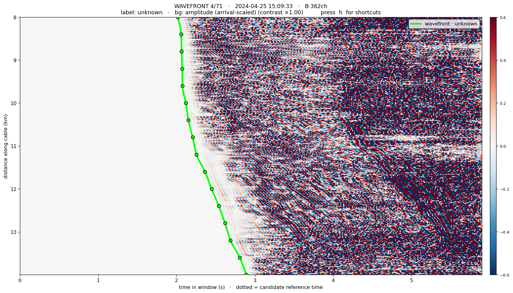
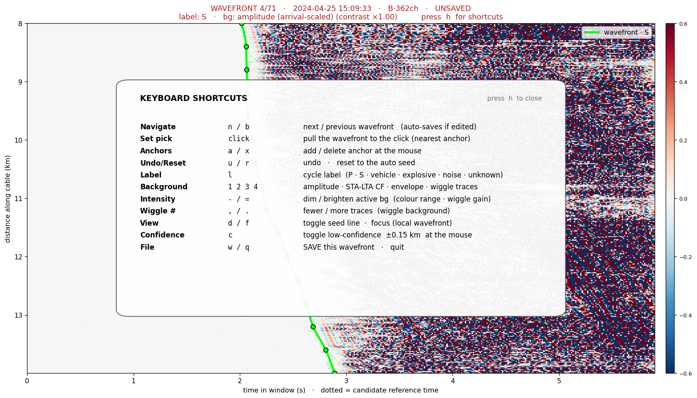
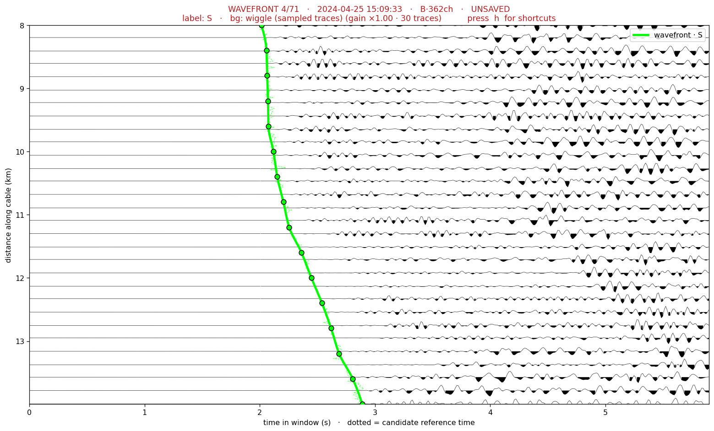
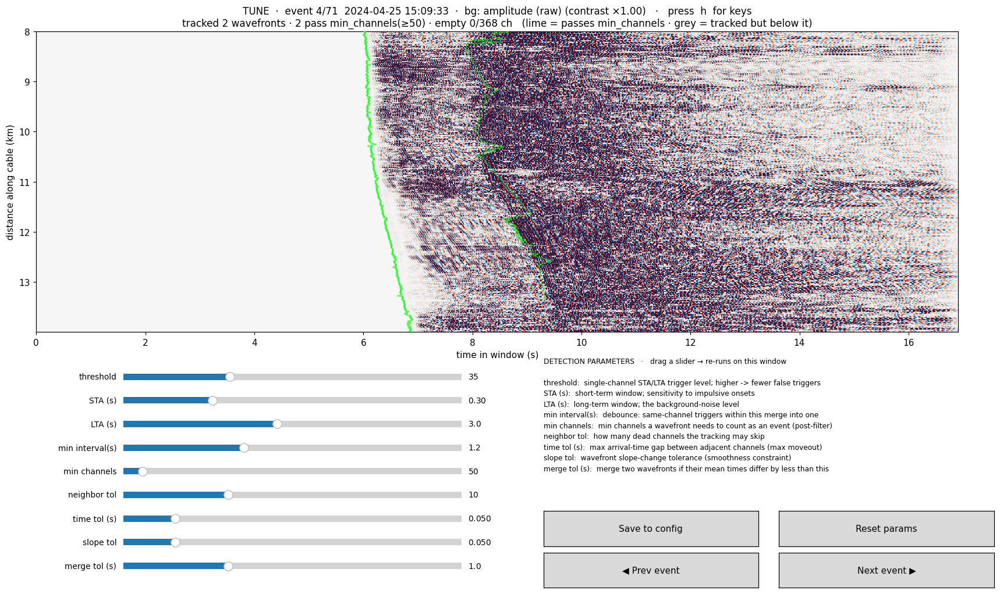
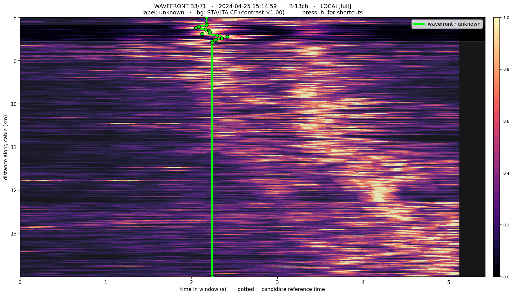
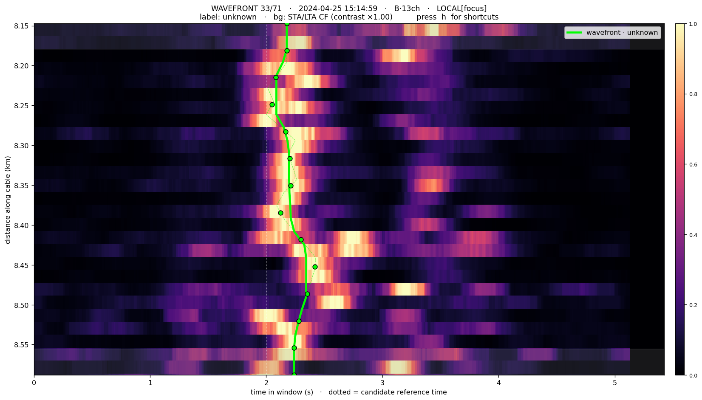

# das_wavefront_picker

[](https://github.com/WANGYuhan2002/das_wavefront_picker/tree/v3.0.1)
[](https://doi.org/10.22541/essoar.15006791/v1)
[](NOTICE)
[](requirements.txt)

> 🌐 **English version → [README_EN.md](README_EN.md)**

**STA/LTA 波前检测 + 交互式波前拾取,一体化工具。**

先用多通道 STA/LTA 从连续 DAS 数据里检测出**候选波前**,再在**每条波前自己的原始 DAS 瀑布图**上
交互式拾取 / 修正,拾好后**打一个标签**(P / S / vehicle / explosive / noise / unknown),
**每条波前单独存成一个 `.h5` 文件**,方便后续按标签筛选。

> **核心理念:原子单位是"波前",没有"事件"。** 一个窗口 = 一条波前 = 一个标签 = 一个文件。
> **不做 P/S 配对、不做事件归并**——波前之间的 association 是之后单独的事,不在这里做。

它整合了两套已有代码:

- **检测** ← `matched_filter_release/stalta_multichan_v1`(方法 A 简单计数 / 方法 B 波前追踪;
  本仓库已包含 `stalta_multichan_v1` 的 STA/LTA 检测功能,`vendor/functions/` 是从那里逐字拷来的,源目录**只读、未改动**,因此 `stalta_multichan_v1` 不再单独建 GitHub 仓库;
  论文用的 STA/LTA 对比基线原包在 Zenodo 压缩包 `matched_filter_release.zip` 的 `stalta_multichan_v1/` 文件夹里;
  其中含 ETH Zürich 的第三方读取器和一段 ObsPy 代码,见 [NOTICE](NOTICE));
- **交互拾取** ← `wavefront_picker`(锚点 + PCHIP + 抖动道集那一套)。

```
工作流:
  STA/LTA 检测       →  逐条浏览候选波前  →  拾取/修正 + 打标签  →  每条存一个 .h5
   run detect             run pick             (窗口里操作)         Picks/wf_*.h5 + 索引 csv
```

**v3:坏道剔除。** 在上面这套(v2,入口 `run.py`)之上,v3 新增入口 `run_v3.py` 和包 `dasapp_v3/`:
先扫描通道质量、生成坏道掩码,再做带掩码的检测,拾取器里再加一层逐事件的置信门控。
v2 的代码没有改,`run.py` 照常可以单独用。见 [§3.1](#31-v3坏道剔除工作流run_v3py) 和
[V3_CHANGES.md](V3_CHANGES.md)。

> **本仓库不含任何 DAS 数据。** 跑 demo / selftest 要先从 Zenodo 下载样例数据,见 [§1 ②](#1-安装与准备)。

---

## 目录

1. [安装与准备（含样例数据）](#1-安装与准备)
2. [五分钟上手 Tutorial](#2-五分钟上手-tutorial) ← 新手从这里开始
3. [命令参考](#3-命令参考)（[3.1 v3:坏道剔除工作流](#31-v3坏道剔除工作流run_v3py)）
4. [配置 config.json](#4-配置-configjson)
5. [快捷键速查](#5-快捷键速查)
6. [输出文件](#6-输出文件)
7. [换成你自己的数据（兼容性）](#7-换成你自己的数据兼容性)
8. [局部波前 / 爆炸源（只影响部分通道）](#8-局部波前--爆炸源只影响部分通道)
9. [常见问题 / Troubleshooting](#9-常见问题--troubleshooting)
10. [目录结构](#10-目录结构)
11. [说明与边界](#11-说明与边界)（含已知例外、版本沿革）
12. [许可证](#12-许可证)
13. [引用](#13-引用)

---

## 1. 安装与准备

**① 装依赖**（Python 3.8+，6 个常见包）:

```bash
cd das_wavefront_picker
pip install -r requirements.txt        # numpy<2.4 scipy matplotlib pandas h5py tqdm
```

> `requirements.txt` 把 numpy 限制在 2.4 以下:numpy ≥ 2.4 时,`vendor/functions/load_das_h5_PE2024.py`
> 第 142 行的 `int(offset_index)` 会抛 `TypeError`,两个 selftest 一读数据就失败。

**② 数据**（看你拿到的是哪个版本）:
- **完整版**（自带 `demo_data/` 文件夹的打包版;**本 GitHub 仓库不是完整版**）:`demo`/`selftest` 会自动找到
  `demo_data/`,**直接跳到第 ③ 步**跑 demo。
- **纯代码版**（**本 GitHub 仓库就是纯代码版**,不含任何 DAS 数据）:把 `config.json` 的 `das_data_dir` 设成你自己的 DAS `.h5` 目录（绝对路径或相对 app 根）。
  想用自带 demo,就把样例 h5（80 Hz/16 m,2024-04-25,来源见下）
  整个放进 **`das_wavefront_picker/demo_data/`**（保留 `20240425/` 子目录）,`demo`/`selftest` 会自动认。
- **样例数据从哪来**:Zenodo 记录 [10.5281/zenodo.20715241](https://doi.org/10.5281/zenodo.20715241)
  的 `matched_filter_release.zip`（约 3.46 GB）。zip 内路径 **`stalta_multichan_v1/IN_DAS_data/20240425/`**,
  共 7 个文件（`Gr_80Hz_16m_20240425_145955.861.h5` … `Gr_80Hz_16m_20240425_152955.861.h5`,
  起始时间每隔 5 分钟一个,每个约 84.5 MB）。
  - `demo`（15:00–15:30）要全部 7 个;
  - 两个 selftest 只要其中 2–3 个:按代码里写定的自检时间窗推算,`run.py selftest`（15:00–15:05）用开头 2 个,
    `run_v3.py selftest`（15:00–15:10）用开头 3 个。
- **数据要求**（换自己的数据时）:HDF5,格式要能被 `vendor/functions/load_das_h5_PE2024.py` 读（见 [第 7 节](#7-换成你自己的数据兼容性)）;
  文件名里要含 `YYYYMMDD_HHMMSS` 形式的起始时间;文件放在 `das_data_dir` 下,或它的 `YYYYMMDD/` 子目录里。
  原始 DAS 文件很大（单个样例约 84.5 MB）,不适合放进 Git 仓库,所以数据一律不进本仓库
  （`.gitignore` 已忽略 `*.h5`、`demo_data/` 和 `Output/`）。

**③ 自检**（需要数据或 demo_data）:

```bash
python3 run.py selftest         # -> [selftest] OK  candidates=... schema=...
python3 run_v3.py selftest      # v3:先查锁定文件哈希,再跑 scan / detect / pick / tune -> [selftest] OK
```

macOS 自动用原生窗口后端。

---

## 2. 五分钟上手 Tutorial

手把手在**样例数据**上跑一遍,从零到拾取并导出你的第一条波前。

> **先准备样例数据**:本仓库不自带数据,先按 [§1 ②](#1-安装与准备) 从 Zenodo 下载 7 个样例 h5,
> 放进 `demo_data/20240425/`。本教程和下文里说的"自带样例",指的都是这份放进 `demo_data/` 的样例。

### 步骤 0 · 一条命令跑起来

```bash
python3 run.py demo
```

或在 Finder 里**双击 `launch.command`**。它会:先在自带 30 分钟样例上跑方法 B 检测
(2024-04-25 15:00–15:30,80 Hz / 16 m)→ **40 条候选波前**;再弹出拾取窗口,停在第 1 条。

> 想快点看到窗口:`python3 run.py demo --quick`(只检测 5 分钟)。

**两个 demo,分清楚**:
> - `python3 run.py demo` —— 检测 + 打开**拾取器**(拾/标波前,本教程主线);
> - `python3 run.py demo --tune` —— 检测 + 打开**调参面板**(滑动条调检测参数,见 [§4.1](#41-交互式调检测参数runpy-tune))。

### 步骤 1 · 看懂这个窗口



- **纵轴** = 沿缆距离(km);**横轴** = 窗口内时间(s);**白色虚线** = 候选波前的参考时刻。
- **绿色曲线** = 当前拾取的波前;圆点 = 可调锚点;**绿色虚线**(较淡)= 自动初值(按 `d` 可隐藏)。
- **标题只显状态**:第 1 行 = 第几条/共几条波前、时间、来源方法与通道数(局部波前多显 `LOCAL[focus]`;
  有未保存改动时**整行变红并显示 `UNSAVED`**);第 2 行 = **当前标签** + 当前背景 + 提示 `按 h 看快捷键`。
- **快捷键不塞在标题里**——按 **`h`** 弹出分组速查浮层(再按 `h` 关掉):

  

### 步骤 2 · 换背景,把到时看清楚

| 键 | 背景 | 用途 |
|----|------|------|
| `1` | 相位自适应振幅(红蓝)| 看波形/振幅 |
| `2` | STA/LTA 特征函数(亮=触发)| **看到时最清楚**,推荐 |
| `3` | 包络 | 能量/尾波范围 |
| `4` | **抖动道集**(采样道逐道画,在同一坐标里)| 逐道核对波形/极性 |

先按 `2`,绿色拾取应当贴着亮弧的**起始(左缘)**。四种背景共用同一坐标轴,随时切换、波前线一直叠在上面。
图像背景右侧有 **colorbar** 显示当前色标范围;按 **`-`/`=`** 调**色标强度**(收紧/放宽映射,越亮越容易看清到时)。

### 步骤 3 · 拾取 / 修正波前

- **左键点击**:把绿线在最近锚点处拉到点击的时间。沿亮弧多点几下就贴上去了。
- `a` 在鼠标处加锚点 · `x` 删最近锚点 · 按 **`4`** 切到**抖动道集背景**逐道核对(绿线正好穿过每道的到时);
  抖动道集里再按 **`-`/`=`** 调**道的振幅**、**`,`/`.`** 调**显示的道数**:

  

- 某段信号差、拾不准?鼠标停那儿按 `c`,±0.15 km 内标**低置信**(灰带,存盘,下游门控掉)。
- `u` 撤销 · `r` 重置回自动初值。

### 步骤 4 · 打标签,保存

- 按 **`l`** 循环设当前波前的**标签**:`P → S → vehicle → explosive → noise → unknown`
  (可在 `config.json` 改词表)。标签显示在标题第 2 行、图例上。
- 按 **`w`** 保存:这条波前**单独存成一个 `.h5`**(`Picks/wf_<时间>_<标签>.h5`),并更新索引。
- 按 **`n`** 下一条、**`b`** 上一条。**改过会自动先保存**——所以可以一路 `n` 浏览,拾过标过的会陆续存下。
- 拾完 `q` 退出。**没拾的就没有,不会产生文件**(只有你动过/标过的才存)。

### 步骤 5 · 看导出了什么

```bash
python3 run.py info
```

拾取结果在 `Output/<实验名>/Picks/`,每条波前一个 `.h5` + 一个 `picks_index.csv` 索引(见 [第 6 节](#6-输出文件))。
下游按标签筛就一行:`df[df.label=="explosive"]`。

### 步骤 6 · 换你自己的数据

编辑 `config.json`(见 [第 4 节](#4-配置-configjson))改 `das_data_dir/fs/dx/freq_band/spatial_range/time_range`,然后 `python3 run.py both`。

> 教程完。下面是完整参考。

---

## 3. 命令参考

v2 统一入口 `run.py <子命令>`（v3 的入口 `run_v3.py` 见 [§3.1](#31-v3坏道剔除工作流run_v3py)）:

| 子命令 | 作用 |
|--------|------|
| `detect` | 只做 STA/LTA 检测 → `Output/<exp>/catalog.csv`(候选波前列表)|
| `pick`   | 打开交互拾取器(`--catalog <csv>` 指定,缺省用检测输出)|
| `both`   | 检测完直接进入拾取 |
| `tune`   | **交互式调检测参数**(滑动条,见 §4.1)|
| `demo`   | 样例数据(`demo_data/`,见 §1 ②):检测 + 拾取(`--quick` 只 5 分钟;`--no-pick` 只检测;`--tune` 改开调参面板)|
| `info`   | 打印配置 + 目录统计 |
| `selftest` | 无界面端到端自检 |

**通用 `--flag`(覆盖 config.json)**,任何子命令都能加:

```
--data <dir>       原始 DAS .h5 目录          --sta 0.3 / --lta 3.0   STA/LTA 窗长(s)
--fs 400           采样率(Hz)                 --method A|B            检测方法
--dx 8.16          通道间距(m)                --threshold 35          单道触发阈值
--band 5 19        带通(Hz)                   --min-channels 50       波前最少通道数
--range 8000 14000 感兴趣距离 d1 d2 (m)       --start / --end <ISO>   时间范围(可只给一端)
--out <dir>        输出根目录
```

例(自己的 400 Hz 数据):

```bash
python3 run.py detect --data /archive/DATA_RAW_400Hz_8m/ --fs 400 --dx 8.16 \
    --band 5 19 --range 8000 14000 --method B \
    --start 2024-04-25T15:00:00 --end 2024-04-25T15:30:00
```

**直接打开已有的 release 目录**(方法 A v1 / 方法 B v2 都认;方法 B 还会从它的 `Wavefronts/*.h5` 读自动波前作初值):

```bash
python3 run.py pick --catalog /path/to/sta_lta_catalog_v2.csv
```

### 3.1 v3：坏道剔除工作流（`run_v3.py`）

v3 在 v2 之上加了一套坏道（低信噪比通道）剔除流程:新入口 `run_v3.py` + 新包 `dasapp_v3/`。
`run.py`、`dasapp/`、`vendor/` 的代码都没有改,v2 照常可以单独用。判据怎么定的、在样例上的实测和
A/B 验收结果,见 **[V3_CHANGES.md](V3_CHANGES.md)**（只有中文）。

两层互相独立的机制:

- **静态质量扫描**（`scan`）:按 10 秒窗统计每条道的能量,判出死道（dead）、持续吵的道（noisy）和
  弱响应道（weak,默认只报告、不屏蔽）,生成通道掩码 `channel_mask.csv`;`detect` 用这个掩码做检测。
- **事件级置信门控**（v3 拾取器）:逐事件、逐道决定 `conf`,这个事件在某条道上看不见,就标成低置信;
  导出的拾取 h5 另外追加 `qc_code`、`snr_db`（v2 的字段一个不动）。

| 子命令 | 作用 |
|--------|------|
| `scan` | 通道质量扫描 → `Output/ChannelQuality/scan_*/`（`channel_quality.csv`、`channel_mask.csv`、`quality_report.png` 等）|
| `mask` | 用新阈值从已有扫描重推掩码,不重读数据（`--scan-dir <目录>`,缺省用最新一次扫描）|
| `detect` | 带掩码的 STA/LTA 检测 → `Output/v3_<exp>_<掩码标签>/`;自动找最新的兼容掩码,没有掩码时报错（先 `scan`,或给 `--mask <csv>` / `--no-mask`）|
| `pick` | v3 拾取器:被屏蔽的道显示红条 + 事件级 conf 门控（`--catalog <csv>`,缺省用检测输出）|
| `tune` | v3 调参面板:按 `m` 实时开/关掩码,看追踪结果的差别 |
| `both` | 检测完直接进入拾取 |
| `demo` | 样例数据（`demo_data/`）:还没有掩码就先扫描,再检测 + 拾取（`--quick` 只 5 分钟;`--tune` 改开调参面板;`--no-pick` 只检测）|
| `compare` | 两个目录的 A/B 对比（`--a <基线 catalog.csv> --b <对比 catalog.csv>`,`--tol` 匹配容差,缺省 1 s）|
| `info` | 打印配置 + 掩码 + 目录统计 |
| `selftest` | 无界面端到端自检:先核对锁定文件的哈希,再跑 scan → 带掩码 detect → pick → tune（样例 15:00–15:10）|

v3 的子命令都接受上面 v2 的通用 `--flag`,另外还有:`--mask <channel_mask.csv>`、`--no-mask`（不用掩码,
等于 v2 的检测）、`--scan-window <s>`、`--z-dead`、`--z-noisy`、`--resp-z`、`--weak-in-mask`、`--snr-gate`。

在自己的数据上第一次用（先在 `config.json` 里设好 `das_data_dir`,或者每条命令都加 `--data <目录>`）:

```bash
python3 run_v3.py scan --start <ISO 开始时刻> --end <ISO 结束时刻>   # V3_CHANGES.md §6.5 建议用整天的数据扫描定掩码
#   看 Output/ChannelQuality/scan_*/quality_report.png;需要时手改 channel_mask.csv,
#   或 python3 run_v3.py mask --z-noisy 2.5（只重推阈值,秒级）
python3 run_v3.py detect               # 自动用最新的兼容掩码
python3 run_v3.py pick
python3 run_v3.py compare --a <v2目录>/catalog.csv --b <v3目录>/catalog.csv   # A/B 验收
```

**锁定文件（pin）**:`dasapp_v3/` 里有几段 v2 代码的逐字拷贝,所以 `dasapp_v3/_pins.py` 记录了 6 个 v2 文件的
SHA256:`dasapp/detect.py`、`dasapp/picker.py`、`dasapp/tune.py`、`dasapp/config.py`、
`vendor/functions/readers.py`、`vendor/functions/stalta.py`。`run_v3.py` 每次启动都会核对,不一致就大声警告,
`selftest` 直接报错。**不要改这 6 个文件**（换行符也不要改）;本仓库的 `.gitattributes` 规定检出一律用 LF,
所以在 Windows 上（`core.autocrlf=true`）克隆也不会误报。

---

## 4. 配置 config.json

| 字段 | 含义 | 样例默认 |
|------|------|---------|
| `das_data_dir` | 原始 DAS `.h5` 目录 | 空（`demo`/`selftest` 自动用 `demo_data/`）|
| `fs` | 采样率 (Hz) | `80` |
| `dx` | 通道间距 (m) | `16.335` |
| `freq_band` | 带通 `[f1, f2]` (Hz) | `[5, 20]` |
| `spatial_range` | 感兴趣距离 `[d1, d2]` (m) | `[8000, 14000]` |
| `sta_len` / `lta_len` | STA / LTA 窗长 (s) | `0.3` / `3.0` |
| `method` | `"A"` 或 `"B"`(推荐,能给拾取初值)| `"B"` |
| `threshold_level` | 单道 STA/LTA 触发阈值 | `35` |
| `minimal_event_interval` | 单道去抖间隔 (s) | `1.2` |
| `min_channels` | 一条波前要求的最少触发通道数 | `50` |
| `tracking_params` | 方法 B：`{neighbor_tol, time_tol, slope_tol}` | `{10, 0.05, 0.05}` |
| `merge_params` | 方法 B：`{merge_time_tol}` (s) | `{1.0}` |
| `time_range` | 处理时间段 `[start, end]` (ISO) | 样例 30 分钟 |
| **`labels`** | **标签受控词表**（按 `l` 循环）| `["P","S","vehicle","explosive","noise","unknown"]` |
| **`default_label`** | 新载入波前的初始标签 | `"unknown"` |
| `pad_pre_s` / `pad_post_s` | 参考时刻前 / 后加载余量 (s) | `2.0` / `3.0` |
| `n_anchors` / `n_wiggle` | 锚点数 / 抖动道集道数 | `16` / `30` |

`min_channels` 高→只留阵列级波前(**局部波前要调低**,见 [第 8 节](#8-局部波前--爆炸源只影响部分通道));
标签用**受控词表**是为了下游筛选永远干净(不会 `P`/`p`/`P-wave` 乱套)——要加类别(如 `coda`)直接改 `labels`。

### 4.1 交互式调检测参数(`run.py tune`)

检测参数不好凭空猜。`tune` 让你**从目录里挑一个代表事件**,用**滑动条**实时调参数,立刻看 STA/LTA + 波前追踪在这个窗口上的结果怎么变;满意了点 **Save to config** 写回 `config.json`,再 `run.py detect` 全量批处理。

```bash
python3 run.py tune --catalog Output/<exp>/catalog.csv     # 缺省用默认目录
```



- 上方瀑布图背景可切:**`1` 原始波形 · `2` STA/LTA · `3` 包络 · `4` 抖动道集**(`,`/`.` 调道数、`-`/`=` 调强度/幅度)——**看原始波形/道集**才好判断改参数后点/波前怎么变。叠加的波前画得**细、半透明**(细线+小点),不遮挡底下精细的信息:**绿**=追踪出且**通过** `min_channels`,**灰**=追踪到但没过阈值。标题实时显示"追踪几条 / 几条通过 / 空道数 / 当前背景"。
- 右侧列出**全部 9 个参数的意义**;下方 9 个滑动条实时调;`Save to config` / `Reset params` / `Prev`·`Next event` 换预览窗口。窗口里按 **`h`** 弹快捷键速查(和拾取器一致),`q` 退出。
- **为什么单独一个模式**:检测决定"有哪些事件",是一次**可复现的批处理产品**(`config_used.json` 记录参数)。把它塞进拾取会让目录参数不一、无法复现——所以 `tune` 只在**一个便宜的预览窗口**上重跑、只输出参数,拾取和目录完全不动。

| 参数 | 意义 | 改动代价 |
|------|------|---------|
| `threshold_level` | 单道 STA/LTA 触发阈值(MAD 归一);高→误报少 | 快(只重跑追踪)|
| `sta_len` | 短时窗;对脉冲到时的敏感度 | 中(重算特征函数)|
| `lta_len` | 长时窗;背景噪声水平 | 中(重算特征函数)|
| `minimal_event_interval` | 单道去抖:此窗内多次触发并成一个 | 快 |
| `min_channels` | 成为事件所需最少通道数(纯后置筛选)| 极快(只重新着色)|
| `neighbor_tol` | 追踪时可跳过的坏道数 | 快 |
| `time_tol` | 相邻道最大时差(控最大视移动)| 快 |
| `slope_tol` | 波前斜率连续性(平滑约束)| 快 |
| `merge_time_tol` | 两波前平均时差 < 此则并为一个事件 | 快 |

> **注意**:一个窗口**不代表全部**——用 `Prev`/`Next` 在**强/弱/噪声**几个事件上都看看再定;`min_channels`、`merge_time_tol` 这类**全局尺度**的效果,最终还得靠一次真 `detect` 确认。

---

## 5. 快捷键速查

(**窗口里随时按 `h` 弹出这张表**;matplotlib 默认快捷键已禁用,用 `w` 存盘)

| 键 | 作用 | 键 | 作用 |
|----|------|----|------|
| `n` / `b` | 下一条 / 上一条波前（改过会自动存）| `r` | 重置回自动初值 |
| 左键点击 | 把波前拉到点击处（最近锚点）| `u` | 撤销 |
| `1` `2` `3` `4` | 背景：振幅 / STA-LTA / 包络 / **抖动道集** | `d` | 显隐自动初值虚线 |
| `-` / `=` | 当前背景色标强度 / wiggle 振幅（减/增）| `,` / `.` | wiggle 显示道数（减/增）|
| **`l`** | **循环设当前波前的标签** | `c` | ±0.15 km 内切换低置信 |
| `a` | 鼠标处加锚点 | `f` | 局部波前：聚焦 ↔ 看整条阵列 |
| `x` | 删最近锚点 | `w` | **保存这条波前** |
| `h` | 帮助 | `q` | 退出 |

---

## 6. 输出文件

**检测** → `Output/<exp>/`:
- `catalog.csv` — 候选波前列表(`start_time, end_time, duration_s, n_channels, avg_amp, method, h5_file, h5_group`;方法 A 另带 `peak_amp/peak_score/max_amp_mean`);
- `config_used.json` — 本次参数;`Wavefronts/Events_<day>.h5` —(方法 B)自动追踪波前,release 原格式。

**拾取** → `Output/<exp>/Picks/`,**每条波前一个文件**:
- `wf_<YYYYMMDD_HHMMSS_ffffff>_<label>.h5` —**标签直接进文件名**,`ls`/`glob('*_explosive.h5')` 一眼就能挑。里面:
  - `wavefront_data` = `[通道号, 到时样点(相对参考时刻), 值]` —**与 release 的 `2_refine_wavefronts.py` 同格式**;
  - `arrival_rel_s`(逐道到时,秒)· `channels`(通道号)· `conf`(逐道置信,低置信/外推为 `False`);
  - attrs:`label, ref_time, fs, n_channels, source, app_slowness_s_per_km, mean_arrival_s, n_conf`。
- 重新打标签再存 = **干净替换**(同一条波前的旧文件会先删掉,不留孤儿)。
- `picks_index.csv` —**一条波前一行**(`file, ref_time, label, source, n_channels, n_conf, mean_arrival_s, app_slowness_s_per_km`),下游按 `label` 一行筛。
- `wf_*.png` — 存盘时截图。

> 打开外部(只读)目录时,拾取结果不会写进那里,而是落到本应用的 `Output/picks_<名>_<哈希>/`(唯一、可写、不串)。

---

## 7. 换成你自己的数据（兼容性）

- **参数**:改 `config.json` 的 `das_data_dir/fs/dx/freq_band/spatial_range/time_range/method`。80 Hz/16 m 与 400 Hz/8 m 只差这些值。
- **读不同 HDF5 格式**:数据加载走 `vendor/functions/load_das_h5_PE2024.py`(Silixa / Pascal-Edme 格式)。h5 结构不同就**改这一个文件**,全应用统一生效。⚠️ 这是"能不能直接在我数据上跑"的**主要变量**——先拿一小段 `run.py detect` 试一次。
- **方法 A vs B**:方法 B 追踪出逐通道波前作拾取初值(**推荐**);方法 A 只给单点峰值,拾取器退回逐通道 STA/LTA 自动拾取作初值。
- **对接已有目录**:`run.py pick --catalog <csv>` 能读任意 release v1/v2 目录。

---

## 8. 局部波前 / 爆炸源（只影响部分通道）

完全支持。**操作上只有一件事**:检测时把 `min_channels` 调低(默认 50 是给阵列级的,`--min-channels 12`
能检出跨度仅 ~20 通道 ≈6% 阵列的波前),其余全自动。四关机制:

**① 检测** — `min_channels` 是闸门,低于它就检不出。方法 B 的链式追踪**天然只沿受影响的相邻通道串出一段波前**,不会跳到整条阵列。

**② 定义"受影响的段" → `conf` 掩码** — 方法 B:tracked 波前的通道范围 `[ch.min,ch.max]` 内 `conf=True`,段外按边缘值平推;方法 A:逐道 STA/LTA 值 > 半阈值才 `True`(逐道更精细)。

**③ 拾取器自动局部模式**(`conf` < 90% 阵列)— 锚点**集中到受影响段**、视图**自动聚焦**、抖动道集只抽该段;按 `f` 切换聚焦/全阵列。

**④ 导出** — 波前覆盖全通道 + `conf` 掩码分开真实/外推。**⚠️ 下游取到时务必按 `conf` 门控**:段外是平推占位、不是真拾取;门控后未受影响通道不引偏差。

| 整条阵列视图（按 `f` 切换）| 自动聚焦（默认）|
|:---:|:---:|
|  |  |
| 同一条只影响 13 通道（≈6% 阵列）的波前——左图它只是顶部一小簇、波前被外推成竖线;右图自动聚焦到 8.15–8.59 km,锚点集中在波前上,直接能拾。||

**诚实边界**:(a) 低于 `min_channels` 的波前**根本检不出**(唯一旋钮=调低阈值,代价是假报增多);(b) 方法 B 的 `conf` 是**外包络范围**,若源是两簇分离的通道,中间会被一起框进——要逐道精确用方法 A。

---

## 9. 常见问题 / Troubleshooting

- **窗口弹不出来 / 用了 Agg** → 你在无显示环境(SSH 无 X11)。本地双击 `launch.command` 或在有显示的终端跑;`selftest` 不需要显示。
- **`catalog not found`** → 先 `run.py detect`,或 `pick --catalog <路径>`。
- **在我数据上读不出/报错** → 多半是 HDF5 格式不符,改 `vendor/functions/load_das_h5_PE2024.py`([第 7 节](#7-换成你自己的数据兼容性))。
- **翻页有点慢** → 逐条从磁盘读原始窗口,远程/慢盘有几百 ms~数秒 I/O 延迟(有 5 条小缓存)。
- **`divide by zero` 警告** → 来自 vendored 内核极短窗口的 warm-up 区,**良性**,不影响结果。
- **检测数太多/太少** → 调 `threshold_level` 和 `min_channels`。
- **验证没改坏** → `run.py selftest`;样例方法 B 应得 **40 条**。
- **`[v3 pin check] ... changed` 警告 / `run_v3.py selftest` 报 pin 错误** → 6 个锁定文件之一的内容变了
  （换行符被改成 CRLF 也算）。用 `git status` / `git diff` 找出来恢复原样,见 [§3.1](#31-v3坏道剔除工作流run_v3py)。
- **读数据时在 `load_das_h5_PE2024.py` 里报 `TypeError`** → numpy 版本 ≥ 2.4。按 `requirements.txt` 装
  numpy 2.4 以下的版本（`pip install "numpy<2.4"`）。
- **先打印 `ERROR! No files found to try loading`,随后报 `UnboundLocalError`（变量 `dd`）** → 读取器在数据目录里
  没找到请求时段的 h5:还没放样例数据,或者目录、文件名和请求的日期对不上。按 [§1 ②](#1-安装与准备) 准备数据
  （没有数据时 `run.py selftest` 就是这样报错的）。

---

## 10. 目录结构

```
das_wavefront_picker/
├── run.py                # v2 入口（detect / pick / both / tune / demo / info / selftest）
├── run_v3.py             # v3 入口：坏道剔除（scan / mask / detect / pick / tune / both / demo / compare / info / selftest）
├── launch.command        # 双击启动（macOS；运行 run.py demo）
├── config.json           # 统一配置（改这里换数据 / 改标签词表）
├── requirements.txt      # 依赖（numpy<2.4）
├── README.md / README_EN.md   # 中/英（手册 + tutorial）
├── V3_CHANGES.md         # v3 的设计、判据标定与 A/B 验收（只有中文）
├── LICENSE               # MIT
├── NOTICE                # vendor/ 里第三方代码的来源和许可
├── LICENSES/             # LGPL-3.0、GPL-3.0 全文（block_filters.py 里的 ObsPy 代码）
├── CITATION.cff          # 引用信息
├── .gitattributes        # 统一用 LF 换行（锁定文件的哈希依赖它）
├── docs/                 # tutorial 配图
├── dasapp/               # v2 应用（v3 没有改它）
│   ├── config.py         # 统一配置：JSON + CLI 合并
│   ├── detect.py         # 方法 A/B 检测（忠实 release 主循环，可复现）
│   ├── catalog.py        # 目录读 + 波前 H5 写（每条一文件）+ 索引
│   ├── dasio.py          # 读窗口 + 返回真实起始时刻（边界对齐）
│   ├── picker.py         # 交互式波前拾取器（+ 无界面 selftest）
│   └── tune.py           # 交互式调检测参数面板（run.py tune）
├── dasapp_v3/            # v3 坏道剔除（全是新文件，见 V3_CHANGES.md §2）
│   ├── _pins.py          # 6 个 v2 文件的 SHA256 守卫
│   ├── config_v3.py      # ConfigV3：quality 参数块 + v3 目录命名 + CLI
│   ├── qcio.py           # 清洗版读入 + 掩码注入点
│   ├── quality.py        # 质量扫描、判定表、掩码产物、重推阈值、护栏告警
│   ├── detect_v3.py      # 带掩码检测（方法 A/B）
│   ├── picker_v3.py      # PickerV3：事件级 conf 门控 + 坏道红条 + qc_code/snr_db 导出
│   ├── tune_v3.py        # TunerV3：掩码叠加显示 + m 键实时开关
│   └── compare_ab.py     # 两个目录的 A/B 对比
└── vendor/functions/     # vendored 只读内核：STA/LTA + DAS reader（自包含；含第三方代码，见 NOTICE）
    ├── readers.py, stalta.py   # 作者自己的 STA/LTA 代码（stalta_multichan_v1）
    ├── load_das_h5_PE2024.py   # DAS 读取器：Pascal Edme（ETH Zürich）
    └── pydas_readers/          # 读取 / 滤波工具：Daniel Bowden（ETH Zürich）；
                                #   util/block_filters.py 含 ObsPy 代码（LGPL-3.0）
```

---

## 11. 说明与边界

- `matched_filter_release/` 全程**只读**:内核是拷贝进 `vendor/` 用的,源文件一字未改。
- **没有"事件"概念**:工具只管拾波前、打标签、单独存文件。波前 association(归事件、P/S 关系)是之后单独做的,**不在这里**。
- **界面性质**:matplotlib 原生窗口的**键盘驱动科学工具**,零额外依赖、离线可用;点击设值而非拖拽,翻页用 `n/b`。
- **阵列两端**邻道少、SNR 低,波前更弱更"混",这些通道标低置信(灰带、存进 `conf`),照实显示供下游门控——不影响双差重定位(δτ 对拾取在亚毫秒/corr>0.999 内不敏感)。
- **可复现**:`nsta/nlta = int(sta_len*fs)` 截断,与 release 一致;样例方法 B = 40 条。
- **已验证**:检测复现 40 条、`selftest`、拾取/标签/翻页/边界/局部波前/每条单独成文件+重标替换;经多轮 agent 对抗评审修复。**未附正式单元测试套件**,`run.py selftest` 是最接近的冒烟测试。
- **已知例外:锁定文件里的路径。** 下面两处都在 `_pins.py` 锁定的文件里,一改就会触发 pin 检查,所以原样保留;
  两处都不影响结果:
  - `vendor/functions/readers.py` 第 43–44 行:两个没被用到的变量 `das_h5_mnt_raw`、`das_h5_mnt_80Hz`,
    写的是采集服务器上原始数据档案的路径（以 `/mnt` 开头;第 16 行的 docstring 和第 30 行的注释里也有这个路径）。
    本应用读数据时总是显式传入 `das_data_dir`,用不到它们。
  - `dasapp/config.py` 第 40–42 行:找 demo 数据时的第二个候选目录,指向原开发目录树里的
    `stalta_multichan_v1/IN_DAS_data`（从 app 根往上两级的相对路径）。别的机器上没有这个目录,会自动跳过,只认 `demo_data/`。
- **版本沿革**:v2.0.0 是检测 + 拾取 + 调参（`run.py`、`dasapp/`;`dasapp/__init__.py` 里的版本号仍是 `2.0.0`）;
  v3.0.0 新增坏道剔除工作流（`run_v3.py`、`dasapp_v3/`）,v3.0.1 用 2024-04-25 全天数据重新标定判据
  （弱响应改为票数比例制,新增 `z_local` 报告列）。本仓库直接从 v3.0.1 的文件树新建,不带原来的开发历史,
  所以 `V3_CHANGES.md` 和 `dasapp_v3/_pins.py` 里提到的 git `3f1241d`（即 v2.0.0）在这里查不到;
  和原开发版相比,代码一行没改:删掉的只有 `vendor/functions/pydas_readers/mapping/` 里 3 个与本项目无关的 CSV
  （见 [NOTICE](NOTICE)）,其余改动都是文档、许可证和配置文件（例如 `requirements.txt` 里的 numpy 上限）。

---

## 12. 许可证

- 为本应用写的代码（`run.py`、`run_v3.py`、`launch.command`、`dasapp/`、`dasapp_v3/` 等）用 **MIT** 许可证,
  版权人 Yuhan Wang,见 [LICENSE](LICENSE)。
- `vendor/functions/` 是从作者的 STA/LTA 包 `stalta_multichan_v1` 逐字节拷来的,里面混有第三方代码,**不全是 MIT**:
  - `readers.py`、`stalta.py`:作者自己的代码,MIT。
  - `pydas_readers/`（Daniel Bowden,ETH Zürich）和 `load_das_h5_PE2024.py`（Pascal Edme,ETH Zürich;
    源自 Sara Klaasen 和 Daniel Bowden 的读取代码）:原作者没有附许可证,版权归原作者。这里经原作者许可,按
    `stalta_multichan_v1` 里的样子原样转载,供科研与可复现使用。
  - `pydas_readers/util/block_filters.py` 含从 ObsPy 直接拷来的代码,这部分按 ObsPy 的 **LGPL-3.0**,
    这个文件不适用 MIT。许可证全文见 [LICENSES/LGPL-3.0.txt](LICENSES/LGPL-3.0.txt) 和
    [LICENSES/GPL-3.0.txt](LICENSES/GPL-3.0.txt)。
- 细节见 [NOTICE](NOTICE)。

---

## 13. 引用

用到本工具时,请引用本软件（[CITATION.cff](CITATION.cff);GitHub 仓库页面上的 "Cite this repository" 会按它生成引用格式）。
相关论文目前是预印本:

> Yuhan Wang, Men-Andrin Meier, Adonis Bogris, Christos Simos, Iraklis Simos, Nikolaos S. Melis, Andreas Fichtner (2026).
> *Persistent Faulting Activity Along the Kefalonia Transform Fault Revealed by Seafloor DAS.* ESS Open Archive（预印本）.
> https://doi.org/10.22541/essoar.15006791/v1

样例数据,以及论文用的 STA/LTA 对比基线原包（检测内核所在的 `stalta_multichan_v1/` 文件夹）,都在 Zenodo 记录
[10.5281/zenodo.20715241](https://doi.org/10.5281/zenodo.20715241) 的 `matched_filter_release.zip` 里。
同批发布的配套 GitHub 仓库：论文匹配滤波工作流 [`WANGYuhan2002/yuhan-mfdas`](https://github.com/WANGYuhan2002/yuhan-mfdas)、
海底 DAS 频谱分析工具 [`WANGYuhan2002/yuhan_das_spectra`](https://github.com/WANGYuhan2002/yuhan_das_spectra)。

---

*Kefalonia 海底 DAS 时空重定位管线的一部分 · 检测/拾取内核来自 Yuhan Wang / ETH Zürich;`vendor/functions/` 里还有
第三方代码:读取 / 滤波工具 `pydas_readers/`（Daniel Bowden）和读取器 `load_das_h5_PE2024.py`（Pascal Edme,源自
Sara Klaasen 和 Daniel Bowden 的代码）,都来自 ETH Zürich;`block_filters.py` 含 ObsPy 的 LGPL-3.0 代码。详见 [NOTICE](NOTICE)。*
