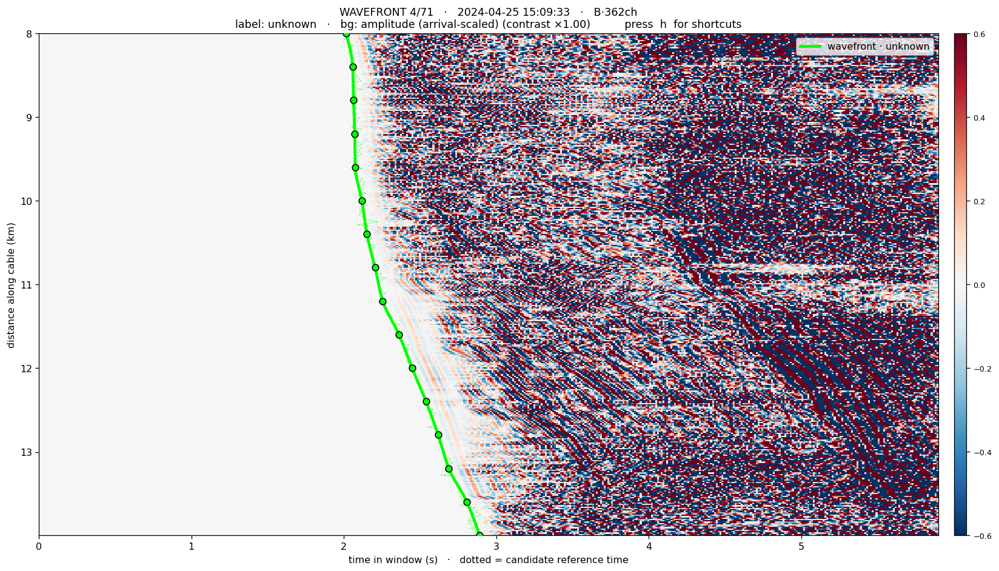
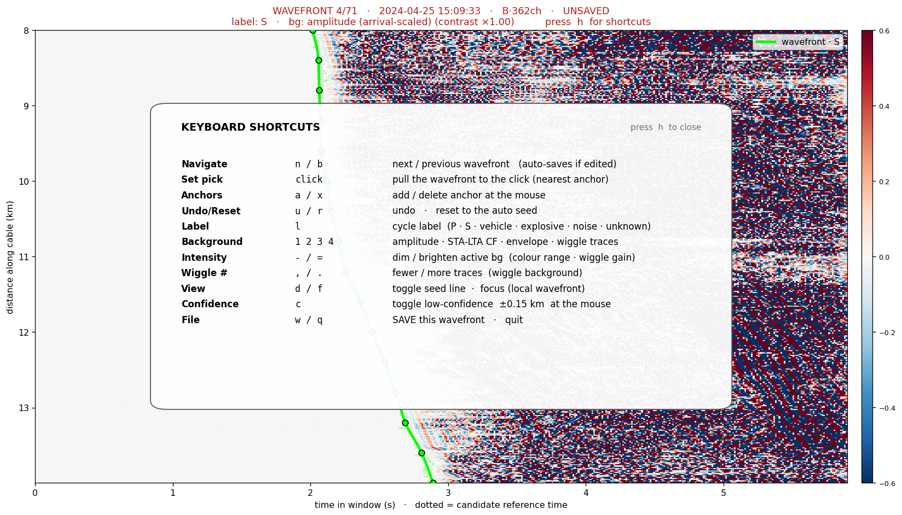
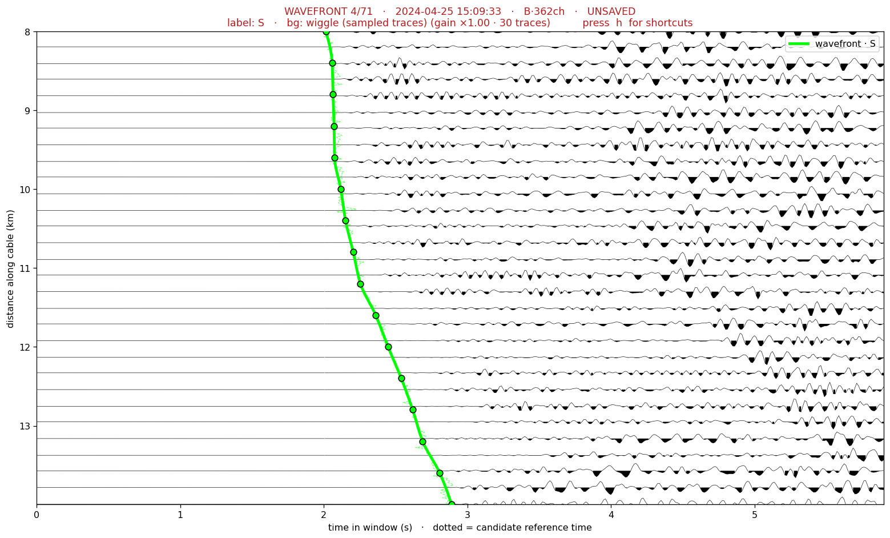
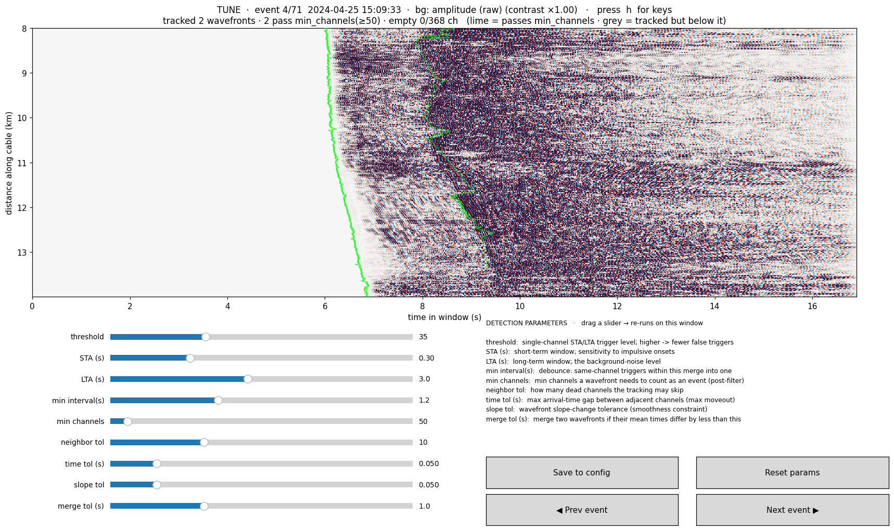
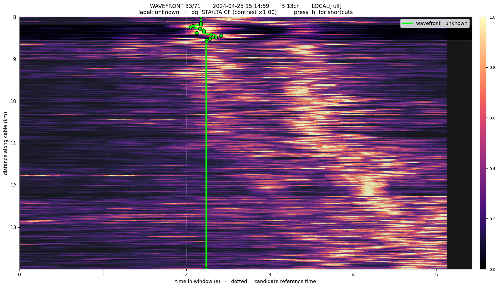
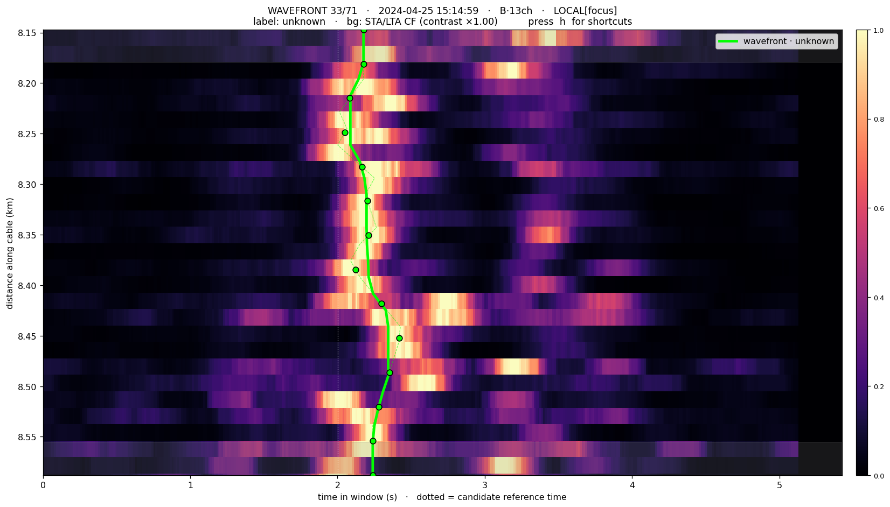

# das_wavefront_picker

> 🌐 **中文版 → [README.md](README.md)**

**STA/LTA wavefront detection + interactive wavefront picking, in one tool.**

Detect candidate **wavefronts** from continuous DAS data with a multichannel STA/LTA, then
interactively pick / refine each wavefront **on its own raw-DAS waterfall**, assign it a
**label** (P / S / vehicle / explosive / noise / unknown), and save **each wavefront as its
own `.h5` file** for easy downstream filtering by label.

> **Core idea: the atomic unit is the WAVEFRONT, not an "event".** One window = one wavefront =
> one label = one file. There is deliberately **no P/S pairing and no event grouping** —
> associating wavefronts is a separate, downstream problem, not done here.

It integrates two existing codebases:

- **Detection** ← `matched_filter_release/stalta_multichan_v1` (Method A simple-count / Method B
  wavefront-tracking; this repository includes the STA/LTA detection of `stalta_multichan_v1` —
  `vendor/functions/` is copied verbatim from it while the source stays **read-only, untouched**, so
  `stalta_multichan_v1` is not published as a separate GitHub repository; the original STA/LTA
  comparison-baseline package used in the paper is in the `stalta_multichan_v1/` folder of
  `matched_filter_release.zip` on Zenodo; it includes third-party DAS readers from ETH Zürich and a
  piece of ObsPy code, see [NOTICE](NOTICE));
- **Interactive picking** ← `wavefront_picker` (the anchor + PCHIP + wiggle-gather machinery).

```
Workflow:
  STA/LTA detect      →  browse candidate wavefronts  →  pick/refine + label  →  one .h5 each
    run detect             run pick                       (in the window)        Picks/wf_*.h5 + index
```

**v3: bad-channel rejection.** On top of the above (v2, entry point `run.py`), v3 adds the entry
point `run_v3.py` and the package `dasapp_v3/`: scan channel quality and build a bad-channel mask,
run masked detection, and add a per-event confidence gate in the picker. The v2 code is unchanged;
`run.py` still works on its own. See [§3.1](#31-v3-bad-channel-rejection-workflow-run_v3py) and
[V3_CHANGES.md](V3_CHANGES.md) (in Chinese only).

> **This repository contains no DAS data.** To run the demo or the selftests, first download the
> sample data from Zenodo, see [§1 step 2](#1-install--set-up).

---

## Contents

1. [Install & set up (incl. sample data)](#1-install--set-up)
2. [Five-minute tutorial](#2-five-minute-tutorial) ← start here
3. [Command reference](#3-command-reference) ([3.1 v3: bad-channel rejection workflow](#31-v3-bad-channel-rejection-workflow-run_v3py))
4. [Configuration (config.json)](#4-configuration-configjson)
5. [Keyboard shortcuts](#5-keyboard-shortcuts)
6. [Output files](#6-output-files)
7. [Using your own data (compatibility)](#7-using-your-own-data-compatibility)
8. [Local wavefronts / explosion sources (partial-channel)](#8-local-wavefronts--explosion-sources-partial-channel)
9. [Troubleshooting](#9-troubleshooting)
10. [Repository layout](#10-repository-layout)
11. [Notes & limitations](#11-notes--limitations) (incl. known exceptions, version history)
12. [License](#12-license)
13. [Citation](#13-citation)

---

## 1. Install & set up

**1) Install deps** (Python 3.8+, six common packages):

```bash
cd das_wavefront_picker
pip install -r requirements.txt        # numpy<2.4 scipy matplotlib pandas h5py tqdm
```

> `requirements.txt` keeps numpy below 2.4: with numpy ≥ 2.4, `int(offset_index)` on line 142 of
> `vendor/functions/load_das_h5_PE2024.py` raises `TypeError`, and both selftests fail on the first
> data read.

**2) Data** (depends which package you got):
- **Full package** (a packaged copy that ships a `demo_data/` folder; **this GitHub repository is
  not the full package**): `demo` / `selftest` find `demo_data/` automatically — **skip to step 3**
  and run the demo.
- **Code-only package** (**this GitHub repository is the code-only package** and contains no DAS
  data): set `das_data_dir` in `config.json` to your own directory of DAS `.h5`
  files. To use the built-in demo, drop the sample h5 files (80 Hz/16 m, 2024-04-25, source below
  — keep the `20240425/` subfolder) into
  **`das_wavefront_picker/demo_data/`**; `demo` / `selftest` auto-detect them.
- **Where the sample data come from**: the file `matched_filter_release.zip` (about 3.46 GB) in the
  Zenodo record [10.5281/zenodo.20715241](https://doi.org/10.5281/zenodo.20715241). Inside the zip
  the path is **`stalta_multichan_v1/IN_DAS_data/20240425/`**: 7 files
  (`Gr_80Hz_16m_20240425_145955.861.h5` … `Gr_80Hz_16m_20240425_152955.861.h5`, start times 5 minutes
  apart, about 84.5 MB each).
  - `demo` (15:00–15:30) needs all 7;
  - the two selftests need only 2–3 of them: going by the selftest windows fixed in the code,
    `run.py selftest` (15:00–15:05) reads the first 2 files and `run_v3.py selftest` (15:00–15:10)
    the first 3.
- **Data requirements** (for your own data): HDF5 in a layout that
  `vendor/functions/load_das_h5_PE2024.py` can read (see [§7](#7-using-your-own-data-compatibility));
  file names must contain the start time as `YYYYMMDD_HHMMSS`; put the files directly in
  `das_data_dir` or in its `YYYYMMDD/` subfolder. Raw DAS files are large (one sample file is about
  84.5 MB) and do not belong in a Git repository, so no data are committed here (`.gitignore`
  ignores `*.h5`, `demo_data/` and `Output/`).

**3) Self-check** (needs data or demo_data present):

```bash
python3 run.py selftest         # -> [selftest] OK  candidates=... schema=...
python3 run_v3.py selftest      # v3: checks the pinned-file hashes, then scan / detect / pick / tune -> [selftest] OK
```

macOS auto-selects a native window backend.

---

## 2. Five-minute tutorial

A hands-on walkthrough on the **sample data**, from zero to picking and exporting your first
wavefront.

> **Prepare the sample data first**: this repository ships no data. Download the 7 sample h5 files
> from Zenodo as described in [§1 step 2](#1-install--set-up) and put them in `demo_data/20240425/`.
> "The bundled sample" in this tutorial and below means that copy in `demo_data/`.

### Step 0 · One command to run it

```bash
python3 run.py demo
```

or **double-click `launch.command`**. It runs Method B detection on the bundled 30-minute sample
(2024-04-25 15:00–15:30, 80 Hz / 16 m) → **40 candidate wavefronts**, then opens the picker on the
first one.

> Want it faster: `python3 run.py demo --quick` (detects only the first 5 minutes).

**Two demos, kept distinct:**
> - `python3 run.py demo` — detect + open the **picker** (pick/label wavefronts; this tutorial's path);
> - `python3 run.py demo --tune` — detect + open the **parameter tuner** (sliders for detection
>   params; see [§4.1](#41-tuning-the-detection-parameters-runpy-tune)).

### Step 1 · Read the window



- **y-axis** = distance along the cable (km); **x-axis** = time within the window (s); the **white
  dotted line** = the candidate's reference time.
- **Green curve** = the current picked wavefront; dots = movable anchors; **faint green dashed line**
  = the automatic seed (press `d` to hide).
- **The title shows state only**: line 1 = wavefront N of total, time, source method & channel count
  (local wavefronts also show `LOCAL[focus]`; unsaved edits turn the **whole line red with
  `UNSAVED`**); line 2 = the **current label** + the active background + the hint `press h for
  shortcuts`.
- **Shortcuts are not crammed into the title** — press **`h`** for a grouped cheat-sheet (press `h`
  again to close):

  

### Step 2 · Switch backgrounds to see the arrival

| key | background | when to use |
|-----|-----------|-------------|
| `1` | phase-adaptive amplitude (red/blue) | waveform / amplitude |
| `2` | STA/LTA characteristic function (bright = trigger) | **clearest for the arrival**, recommended |
| `3` | envelope | energy / coda extent |
| `4` | **wiggle gather** (sampled traces, in the same axes) | check individual waveforms / polarity |

Press `2` first — the green pick should sit on the bright arc's **onset (left edge)**. All four
backgrounds share the same axes, switch freely, and the wavefront line stays overlaid. Image
backgrounds show a **colorbar** on the right for the current range; press **`-`/`=`** to tune the
**colour intensity** (tighter = brighter, easier to see the arrival).

### Step 3 · Pick / refine the wavefront

- **Left-click**: pull the green line, at the nearest anchor, to the time you clicked. Click along
  the bright arc a few times and it snaps on.
- `a` add an anchor at the mouse · `x` delete the nearest · press **`4`** for the **wiggle-gather
  background** to cross-check single traces (the green line crosses each trace at its arrival); in
  the wiggle view, **`-`/`=`** tune the **trace amplitude** and **`,`/`.`** the **number of traces**:

  

- A noisy stretch? Hover and press `c` to flag ±0.15 km as **low-confidence** (grey band; saved,
  gated out downstream).
- `u` undo · `r` reset to the auto seed.

### Step 4 · Label it, save it

- Press **`l`** to cycle the wavefront's **label**: `P → S → vehicle → explosive → noise → unknown`
  (edit the vocabulary in `config.json`). The label shows in the title and legend.
- Press **`w`** to save: this wavefront is written as **its own `.h5`** (`Picks/wf_<time>_<label>.h5`)
  and the index is updated.
- Press **`n`** for the next wavefront, **`b`** for the previous. **Editing auto-saves first**, so you
  can walk through with `n` and picked+labelled wavefronts get saved along the way.
- Press `q` to quit. **Un-picked wavefronts produce no file** — only what you touched/labelled is saved.

### Step 5 · See what you exported

```bash
python3 run.py info
```

Picks live in `Output/<exp>/Picks/`, one `.h5` per wavefront + a `picks_index.csv`
([§6](#6-output-files)). Downstream filtering is a one-liner: `df[df.label == "explosive"]`.

### Step 6 · Switch to your own data

Edit `config.json` ([§4](#4-configuration-configjson)) — `das_data_dir / fs / dx / freq_band /
spatial_range / time_range` — then `python3 run.py both`.

> End of tutorial. Full reference below.

---

## 3. Command reference

v2 entry point `run.py <subcommand>` (for the v3 entry point `run_v3.py` see
[§3.1](#31-v3-bad-channel-rejection-workflow-run_v3py)):

| subcommand | what it does |
|------------|--------------|
| `detect` | STA/LTA detection only → `Output/<exp>/catalog.csv` (list of candidate wavefronts) |
| `pick`   | open the picker on a folder (`--catalog <csv>`; defaults to the detect output) |
| `both`   | detect, then pick |
| `tune`   | **interactive detection-parameter tuner** (sliders, see §4.1) |
| `demo`   | sample data (`demo_data/`, see §1 step 2): detect + pick (`--quick` = 5 min; `--no-pick` = detect only; `--tune` = open the tuner instead) |
| `info`   | print config + folder stats |
| `selftest` | headless end-to-end check |

**Common `--flags` (override config.json)**, valid on any subcommand:

```
--data <dir>       raw DAS .h5 directory        --sta 0.3 / --lta 3.0   STA/LTA windows (s)
--fs 400           sampling rate (Hz)           --method A|B            detection method
--dx 8.16          channel spacing (m)          --threshold 35          single-channel threshold
--band 5 19        bandpass (Hz)                --min-channels 50       min channels per wavefront
--range 8000 14000 ROI distances d1 d2 (m)      --start / --end <ISO>   time range (either alone OK)
--out <dir>        output root
```

Example (your own 400 Hz data):

```bash
python3 run.py detect --data /archive/DATA_RAW_400Hz_8m/ --fs 400 --dx 8.16 \
    --band 5 19 --range 8000 14000 --method B \
    --start 2024-04-25T15:00:00 --end 2024-04-25T15:30:00
```

**Open an existing matched_filter_release folder directly** (Method A v1 / Method B v2; Method B also
seeds picks from its `Wavefronts/*.h5`):

```bash
python3 run.py pick --catalog /path/to/sta_lta_catalog_v2.csv
```

### 3.1 v3: bad-channel rejection workflow (`run_v3.py`)

v3 adds a bad-channel (low-SNR channel) rejection workflow on top of v2: the new entry point
`run_v3.py` and the new package `dasapp_v3/`. The code in `run.py`, `dasapp/` and `vendor/` is
unchanged, so v2 still works on its own. How the criteria were calibrated, the measurements on the
sample and the A/B acceptance results are in **[V3_CHANGES.md](V3_CHANGES.md) — available in
Chinese only**.

Two independent mechanisms:

- **Static quality scan** (`scan`): computes per-channel energy in 10-second windows, flags dead
  channels, persistently noisy channels and weak responders (weak = advisory by default, not
  masked), and writes a channel mask `channel_mask.csv`; `detect` uses that mask.
- **Event-level confidence gate** (v3 picker): decides `conf` per event and per channel; a channel
  on which this event is not visible becomes low-confidence. The exported pick h5 additionally gets
  `qc_code` and `snr_db` (all v2 fields are kept as they are).

| subcommand | what it does |
|------------|--------------|
| `scan` | channel-quality scan → `Output/ChannelQuality/scan_*/` (`channel_quality.csv`, `channel_mask.csv`, `quality_report.png`, …) |
| `mask` | re-derive the mask from an existing scan with new thresholds, without re-reading data (`--scan-dir <dir>`; default: newest scan) |
| `detect` | masked STA/LTA detection → `Output/v3_<exp>_<mask tag>/`; picks the newest compatible mask automatically and stops with an error if there is none (run `scan` first, or pass `--mask <csv>` / `--no-mask`) |
| `pick` | v3 picker: masked channels shown as red stripes + event-level conf gate (`--catalog <csv>`; defaults to the detect output) |
| `tune` | v3 tuner: press `m` to toggle the mask live and compare the tracking |
| `both` | detect, then pick |
| `demo` | sample data (`demo_data/`): scans first if there is no mask yet, then detect + pick (`--quick` = 5 min; `--tune` = open the tuner; `--no-pick` = detect only) |
| `compare` | A/B-compare two catalogs (`--a <baseline catalog.csv> --b <comparison catalog.csv>`, `--tol` match tolerance, default 1 s) |
| `info` | print config + mask + catalog stats |
| `selftest` | headless end-to-end check: verifies the pinned-file hashes, then scan → masked detect → pick → tune (sample, 15:00–15:10) |

All v3 subcommands accept the common v2 `--flags` above, plus: `--mask <channel_mask.csv>`,
`--no-mask` (no mask, i.e. v2 detection), `--scan-window <s>`, `--z-dead`, `--z-noisy`, `--resp-z`,
`--weak-in-mask`, `--snr-gate`.

A first session on your own data (set `das_data_dir` in `config.json` first, or add `--data <dir>`
to every command):

```bash
python3 run_v3.py scan --start <ISO start> --end <ISO end>   # V3_CHANGES.md §6.5 recommends a full-day scan for the mask
#   inspect Output/ChannelQuality/scan_*/quality_report.png; hand-edit channel_mask.csv if needed,
#   or: python3 run_v3.py mask --z-noisy 2.5   (re-thresholds only, takes seconds)
python3 run_v3.py detect               # uses the newest compatible mask automatically
python3 run_v3.py pick
python3 run_v3.py compare --a <v2 folder>/catalog.csv --b <v3 folder>/catalog.csv   # A/B check
```

**Pinned files**: `dasapp_v3/` carries a few verbatim copies of v2 code, so `dasapp_v3/_pins.py`
records the SHA256 of 6 v2 files: `dasapp/detect.py`, `dasapp/picker.py`, `dasapp/tune.py`,
`dasapp/config.py`, `vendor/functions/readers.py`, `vendor/functions/stalta.py`. `run_v3.py` checks
them on every start and warns loudly on a mismatch; `selftest` stops with an error. **Do not edit
these 6 files** (not even their line endings). This repository's `.gitattributes` makes Git check
files out with LF line endings, so a clone on Windows (`core.autocrlf=true`) does not trip the check.

---

## 4. Configuration (config.json)

| field | meaning | sample default |
|-------|---------|----------------|
| `das_data_dir` | raw DAS `.h5` directory | empty (`demo` / `selftest` use `demo_data/` automatically) |
| `fs` | sampling rate (Hz) | `80` |
| `dx` | channel spacing (m) | `16.335` |
| `freq_band` | bandpass `[f1, f2]` (Hz) | `[5, 20]` |
| `spatial_range` | ROI distances `[d1, d2]` (m) | `[8000, 14000]` |
| `sta_len` / `lta_len` | STA / LTA windows (s) | `0.3` / `3.0` |
| `method` | `"A"` or `"B"` (recommended, seeds picks) | `"B"` |
| `threshold_level` | single-channel STA/LTA threshold | `35` |
| `minimal_event_interval` | per-channel debounce (s) | `1.2` |
| `min_channels` | min channels for a wavefront | `50` |
| `tracking_params` | Method B: `{neighbor_tol, time_tol, slope_tol}` | `{10, 0.05, 0.05}` |
| `merge_params` | Method B: `{merge_time_tol}` (s) | `{1.0}` |
| `time_range` | processing window `[start, end]` (ISO) | sample 30 min |
| **`labels`** | **controlled label vocabulary** (cycled by `l`) | `["P","S","vehicle","explosive","noise","unknown"]` |
| **`default_label`** | label a freshly-loaded wavefront starts with | `"unknown"` |
| `pad_pre_s` / `pad_post_s` | window pad before / after the reference time (s) | `2.0` / `3.0` |
| `n_anchors` / `n_wiggle` | anchors / wiggle traces | `16` / `30` |

Higher `min_channels` → only array-wide wavefronts (**lower it for local ones**, see
[§8](#8-local-wavefronts--explosion-sources-partial-channel)). Labels are a **controlled vocabulary**
so downstream filtering stays clean (no `P` / `p` / `P-wave` drift) — add classes (e.g. `coda`) by
editing `labels`.

### 4.1 Tuning the detection parameters (`run.py tune`)

Detection parameters are hard to guess blind. `tune` lets you **pick a representative event from a
catalog** and drag **sliders** while watching how the STA/LTA + wavefront-tracking result changes on
that one window live; when it looks right, click **Save to config** to write the values back to
`config.json`, then run the full `run.py detect` batch.

```bash
python3 run.py tune --catalog Output/<exp>/catalog.csv     # defaults to the config's catalog
```



- The top waterfall background switches with **`1` raw amplitude · `2` STA/LTA · `3` envelope ·
  `4` wiggle** (`,`/`.` set wiggle density, `-`/`=` the colour/amplitude intensity) — seeing the
  **raw waveform / traces** is what lets you judge how a parameter change moves the picks/wavefront.
  The tracked wavefronts are drawn **thin and semi-transparent** (fine line + small dots) so they
  don't mask the detailed data underneath: **lime** = tracked AND passing `min_channels`, **grey** =
  tracked but below it. The title shows tracked / passing / empty-channel counts + the current background.
- The right panel lists **all 9 parameters and their meanings**; the 9 sliders adjust them live;
  `Save to config` / `Reset params` / `Prev`·`Next event` switch the preview window. Press **`h`**
  for the shortcut overlay (same as the picker), `q` to quit.
- **Why a separate mode**: detection defines *which events exist* — a reproducible batch product
  (`config_used.json` records the params). Tuning it inside the picker would make the catalog
  inconsistent, so `tune` only ever re-runs on ONE cheap preview window and emits parameters; picking
  and the catalog are untouched.

| Parameter | Meaning | Recompute cost |
|-----------|---------|----------------|
| `threshold_level` | single-channel STA/LTA trigger level; higher → fewer false triggers | fast (re-track) |
| `sta_len` | short-term window; sensitivity to impulsive onsets | medium (recompute CF) |
| `lta_len` | long-term window; the background-noise level | medium (recompute CF) |
| `minimal_event_interval` | debounce: same-channel triggers within this merge into one | fast |
| `min_channels` | min channels a wavefront needs to be an event (post-filter) | instant (re-colour) |
| `neighbor_tol` | how many dead channels the tracking may skip | fast |
| `time_tol` | max arrival-time gap between adjacent channels (max moveout) | fast |
| `slope_tol` | wavefront slope-change tolerance (smoothness) | fast |
| `merge_time_tol` | merge two wavefronts if their mean times differ by less than this | fast |

> **Caveat**: one window isn't representative — use `Prev`/`Next` to check **strong / weak / noisy**
> events before committing, and confirm the **global-scale** params (`min_channels`, `merge_time_tol`)
> with one real `detect` run.

---

## 5. Keyboard shortcuts

(**Press `h` any time to pop up this table**; default matplotlib shortcuts are disabled, so use `w`
to save.)

| key | action | key | action |
|-----|--------|-----|--------|
| `n` / `b` | next / previous wavefront (auto-saves if edited) | `r` | reset to the auto seed |
| left-click | pull the wavefront to the click (nearest anchor) | `u` | undo |
| `1` `2` `3` `4` | background: amplitude / STA-LTA / envelope / **wiggle** | `d` | show/hide the seed dashed line |
| `-` / `=` | active-bg colour intensity / wiggle amplitude (down/up) | `,` / `.` | wiggle trace count (down/up) |
| **`l`** | **cycle the wavefront's label** | `c` | toggle low-confidence ±0.15 km |
| `a` | add an anchor at the mouse | `f` | local wavefront: focus ↔ full array |
| `x` | delete the nearest anchor | `w` | **save this wavefront** |
| `h` | help | `q` | quit |

---

## 6. Output files

**Detection** → `Output/<exp>/`:
- `catalog.csv` — list of candidate wavefronts (`start_time, end_time, duration_s, n_channels,
  avg_amp, method, h5_file, h5_group`; Method A also `peak_amp/peak_score/max_amp_mean`);
- `config_used.json` — parameters used; `Wavefronts/Events_<day>.h5` — (Method B) the automatic
  tracked wavefronts, release format.

**Picking** → `Output/<exp>/Picks/`, **one file per wavefront**:
- `wf_<YYYYMMDD_HHMMSS_ffffff>_<label>.h5` — **the label is in the filename**, so
  `ls` / `glob('*_explosive.h5')` filters at a glance. Inside:
  - `wavefront_data` = `[channel_idx, time_idx_samples (rel. to ref time), value]` — **drop-in for
    the release's `2_refine_wavefronts.py`**;
  - `arrival_rel_s` (per-channel arrival, s) · `channels` · `conf` (per-channel confidence, `False`
    on low-confidence / extrapolated);
  - attrs: `label, ref_time, fs, n_channels, source, app_slowness_s_per_km, mean_arrival_s, n_conf`.
- Re-labelling and re-saving **replaces cleanly** (the prior file for that wavefront is removed — no
  orphans).
- `picks_index.csv` — **one row per wavefront** (`file, ref_time, label, source, n_channels, n_conf,
  mean_arrival_s, app_slowness_s_per_km`), for one-line downstream filtering by `label`.
- `wf_*.png` — a screenshot at save time.

> When opening an external (read-only) folder, picks are NOT written there — they go to this app's
> `Output/picks_<tag>_<hash>/` (unique, writable, never colliding).

---

## 7. Using your own data (compatibility)

- **Parameters**: edit `das_data_dir / fs / dx / freq_band / spatial_range / time_range / method` in
  `config.json`. 80 Hz/16 m vs 400 Hz/8 m differ only in these.
- **Reading a different HDF5 format**: loading goes through `vendor/functions/load_das_h5_PE2024.py`
  (Silixa / Pascal-Edme). Different layout → **edit that one file**. ⚠️ This is the **main variable**
  for "will it just work on my data" — try a short window with `run.py detect` first.
- **Method A vs B**: Method B tracks a per-channel wavefront as the pick seed (**recommended**);
  Method A gives single-point peaks, so the picker falls back to a per-channel STA/LTA auto-pick.
- **Reuse existing folders**: `run.py pick --catalog <csv>` reads any release v1/v2 folder.

---

## 8. Local wavefronts / explosion sources (partial-channel)

Fully supported. **Operationally, just one thing**: lower `min_channels` at detection (default 50 is
for array-wide; `--min-channels 12` catches wavefronts spanning as few as ~20 channels ≈ 6% of the
array). The rest is automatic. Four stages:

**① Detection** — `min_channels` is the gate; below it, not detected. Method B's chain-tracking
**naturally strings a wavefront only along the affected neighbouring channels**, not across the array.

**② Defining "the affected span" → the `conf` mask** — Method B: `conf=True` inside the tracked
wavefront's channel range `[ch.min, ch.max]`, flat-extrapolated beyond; Method A: `True` only where
the per-channel STA/LTA value exceeds half the threshold (finer, per-channel).

**③ The picker auto-enters local mode** (`conf` < 90% of the array) — anchors **concentrate on the
span**, the view **auto-focuses**, the wiggle samples only that span; press `f` to toggle
focus / full-array.

**④ Export** — the wavefront covers all channels + a `conf` mask separating real picks from
extrapolation. **⚠️ Downstream MUST gate arrivals on `conf`**: outside the span the values are a flat
placeholder, not a real pick; once gated, unaffected channels introduce no bias.

| Full-array view (toggle with `f`) | Auto-focus (default) |
|:---:|:---:|
|  |  |
| The same wavefront lighting up only 13 channels (≈6% of the array) — on the left a tiny cluster with the wavefront extrapolated as a vertical line; on the right auto-focused to 8.15–8.59 km, anchors on the wavefront, ready to pick. ||

**Honest edges**: (a) a wavefront below `min_channels` is **simply not detected** (only knob:
lower the threshold, at the cost of more false alarms); (b) Method B's `conf` is the **bounding
range**, so a two-cluster source sweeps in the gap between clusters — use Method A for a strict
per-channel mask.

---

## 9. Troubleshooting

- **No window / uses Agg** → headless environment (SSH without X11). Run locally via
  `launch.command` or a terminal with a display; `selftest` needs no display.
- **`catalog not found`** → run `run.py detect` first, or `pick --catalog <path>`.
- **Errors / no data on my own data** → almost certainly an HDF5-format mismatch; edit
  `vendor/functions/load_das_h5_PE2024.py` ([§7](#7-using-your-own-data-compatibility)).
- **Navigation feels slow** → each window is read from disk; remote/slow disks add I/O latency (a
  5-window cache helps).
- **Occasional `divide by zero` warning** → from the vendored kernel's warm-up on very short windows;
  benign, no effect on results.
- **Too many / too few detections** → tune `threshold_level` and `min_channels`.
- **Verify nothing broke** → `run.py selftest`; the bundled sample with Method B should give
  **40 wavefronts**.
- **`[v3 pin check] ... changed` warning / `run_v3.py selftest` fails the pin check** → one of the
  6 pinned files changed (CRLF line endings count as a change). Find it with `git status` /
  `git diff` and restore it; see [§3.1](#31-v3-bad-channel-rejection-workflow-run_v3py).
- **`TypeError` inside `load_das_h5_PE2024.py` when reading data** → numpy ≥ 2.4. Install a numpy
  below 2.4 as `requirements.txt` says (`pip install "numpy<2.4"`).
- **`ERROR! No files found to try loading`, followed by an `UnboundLocalError` (variable `dd`)** →
  the reader found no h5 file for the requested time span in the data folder: the sample data are
  not in place yet, or the folder / file names do not match the requested dates. Prepare the data
  as in [§1 step 2](#1-install--set-up) (this is how `run.py selftest` fails when there is no data).

---

## 10. Repository layout

```
das_wavefront_picker/
├── run.py                # v2 entry point (detect / pick / both / tune / demo / info / selftest)
├── run_v3.py             # v3 entry point, bad-channel rejection (scan / mask / detect / pick / tune / both / demo / compare / info / selftest)
├── launch.command        # double-click launcher (macOS; runs run.py demo)
├── config.json           # unified config (switch data / edit the label vocabulary here)
├── requirements.txt      # dependencies (numpy<2.4)
├── README.md / README_EN.md   # 中文 / English (reference + tutorial)
├── V3_CHANGES.md         # v3 design, criteria calibration and A/B acceptance (Chinese only)
├── LICENSE               # MIT
├── NOTICE                # origin and terms of the third-party code in vendor/
├── LICENSES/             # full LGPL-3.0 and GPL-3.0 texts (ObsPy code in block_filters.py)
├── CITATION.cff          # citation metadata
├── .gitattributes        # LF line endings everywhere (the pinned-file hashes depend on it)
├── docs/                 # tutorial images
├── dasapp/               # the v2 application (not modified by v3)
│   ├── config.py         # unified config: JSON + CLI merge
│   ├── detect.py         # Method A/B detection (faithful to the release loops, reproducible)
│   ├── catalog.py        # catalog read + wavefront-H5 write (one file each) + index
│   ├── dasio.py          # read a window + return its true start time (boundary alignment)
│   ├── picker.py         # interactive wavefront picker (+ headless selftest)
│   └── tune.py           # interactive detection-parameter tuner (run.py tune)
├── dasapp_v3/            # v3 bad-channel rejection (all new files, see V3_CHANGES.md §2)
│   ├── _pins.py          # SHA256 guard for 6 v2 files
│   ├── config_v3.py      # ConfigV3: quality parameter block + v3 folder naming + CLI
│   ├── qcio.py           # cleaned read-in + mask injection point
│   ├── quality.py        # quality scan, verdict table, mask artifacts, re-thresholding, guardrails
│   ├── detect_v3.py      # masked detection (Method A/B)
│   ├── picker_v3.py      # PickerV3: event-level conf gate + bad-channel stripes + qc_code/snr_db export
│   ├── tune_v3.py        # TunerV3: mask overlay + live toggle with m
│   └── compare_ab.py     # A/B comparison of two catalogs
└── vendor/functions/     # vendored read-only kernel: STA/LTA + DAS reader (self-contained; includes third-party code, see NOTICE)
    ├── readers.py, stalta.py   # the author's own STA/LTA code (stalta_multichan_v1)
    ├── load_das_h5_PE2024.py   # DAS reader by Pascal Edme (ETH Zürich)
    └── pydas_readers/          # reading / filtering utilities by Daniel Bowden (ETH Zürich);
                                #   util/block_filters.py contains ObsPy code (LGPL-3.0)
```

---

## 11. Notes & limitations

- `matched_filter_release/` is **read-only** throughout: the kernel is a copy in `vendor/`, the
  source is untouched.
- **No "event" concept**: the tool only picks wavefronts, labels them, and saves one file each.
  Associating wavefronts (into events, P/S relations) is a separate, downstream step — **not here**.
- **Interface nature**: a keyboard-driven scientific tool in a native matplotlib window — zero extra
  dependencies, works offline; click-to-set rather than drag, `n/b` to navigate.
- **Array ends** have few neighbours and low SNR, so the wavefront there is weaker / more mixed;
  those channels are flagged low-confidence (grey band, saved into `conf`) and shown honestly for
  downstream gating — this does not affect double-difference relocation (δτ is insensitive to the
  pick to sub-ms / corr > 0.999).
- **Reproducibility**: `nsta/nlta = int(sta_len*fs)` truncation, matching the release; the bundled
  sample with Method B = 40 wavefronts.
- **Verified**: 40-wavefront reproduction, `selftest`, picking/label/navigation/boundaries/local
  wavefronts/one-file-per-wavefront + clean relabel; hardened via multi-agent adversarial review.
  **No formal unit-test suite is shipped**; `run.py selftest` is the closest smoke test.
- **Known exceptions: paths inside pinned files.** Both of the following are in files pinned by
  `_pins.py`, so editing them would trip the pin check; they are left as they are and neither
  affects the results:
  - `vendor/functions/readers.py` lines 43–44: two unused variables, `das_h5_mnt_raw` and
    `das_h5_mnt_80Hz`, holding paths (starting with `/mnt`) of the raw-data archive on the acquisition server
    (the same path also appears in the docstring on line 16 and the comment on line 30). The app
    always passes `das_data_dir` explicitly when reading data, so they are never used.
  - `dasapp/config.py` lines 40–42: the second candidate folder searched for demo data, pointing at
    `stalta_multichan_v1/IN_DAS_data` in the original development tree (a relative path two levels
    above the app root). On any other machine that folder does not exist and is skipped; only
    `demo_data/` is used.
- **Version history**: v2.0.0 is detection + picking + tuning (`run.py`, `dasapp/`; the version
  string in `dasapp/__init__.py` is still `2.0.0`); v3.0.0 added the bad-channel rejection workflow
  (`run_v3.py`, `dasapp_v3/`), and v3.0.1 recalibrated its criteria on the full day of 2024-04-25
  (vote-fraction rule for weak responders, new `z_local` report column). This repository was
  created fresh from the v3.0.1 file tree, without the original development history, so the git
  commit `3f1241d` (= v2.0.0) mentioned in `V3_CHANGES.md` and `dasapp_v3/_pins.py` does not exist
  here. Compared with the original development copy, no code was changed: the only removal is 3
  unrelated CSV files from `vendor/functions/pydas_readers/mapping/` (see [NOTICE](NOTICE)), and all
  other changes are documentation, license and configuration files (e.g. the numpy upper bound in
  `requirements.txt`).

---

## 12. License

- The code written for this application (`run.py`, `run_v3.py`, `launch.command`, `dasapp/`,
  `dasapp_v3/`, …) is licensed under the **MIT** License, copyright Yuhan Wang; see
  [LICENSE](LICENSE).
- `vendor/functions/` is a verbatim copy from the author's STA/LTA package `stalta_multichan_v1` and
  mixes in third-party code, so it is **not all MIT**:
  - `readers.py`, `stalta.py`: the author's own code, MIT.
  - `pydas_readers/` (Daniel Bowden, ETH Zürich) and `load_das_h5_PE2024.py` (Pascal Edme, ETH
    Zürich; derived from reader code by Sara Klaasen and Daniel Bowden): their authors attached no
    license and keep all rights. They are redistributed here without changes (as found in
    `stalta_multichan_v1`), for research and reproducibility, with the permission of the original authors.
  - `pydas_readers/util/block_filters.py` contains code taken directly from ObsPy; that code is
    under ObsPy's **LGPL-3.0**, and the MIT License does not apply to this file. Full texts:
    [LICENSES/LGPL-3.0.txt](LICENSES/LGPL-3.0.txt) and [LICENSES/GPL-3.0.txt](LICENSES/GPL-3.0.txt).
- Details: [NOTICE](NOTICE).

---

## 13. Citation

If you use this tool, please cite the software ([CITATION.cff](CITATION.cff); the "Cite this
repository" button on the GitHub page builds a citation from it). The related paper is currently a
preprint:

> Yuhan Wang, Men-Andrin Meier, Adonis Bogris, Christos Simos, Iraklis Simos, Nikolaos S. Melis, Andreas Fichtner (2026).
> *Persistent Faulting Activity Along the Kefalonia Transform Fault Revealed by Seafloor DAS.* ESS Open Archive (preprint).
> https://doi.org/10.22541/essoar.15006791/v1

The sample data, as well as the original STA/LTA comparison-baseline package used in the paper (the
`stalta_multichan_v1/` folder where the detection kernel comes from), are in `matched_filter_release.zip`
of the Zenodo record [10.5281/zenodo.20715241](https://doi.org/10.5281/zenodo.20715241). Companion
GitHub repositories from the same release: the paper's matched-filter workflow
[`WANGYuhan2002/yuhan-mfdas`](https://github.com/WANGYuhan2002/yuhan-mfdas) and the seafloor-DAS
spectral analysis tools [`WANGYuhan2002/yuhan_das_spectra`](https://github.com/WANGYuhan2002/yuhan_das_spectra).

---

*Part of the Kefalonia seafloor-DAS spatiotemporal relocation pipeline · detection/picking kernel by
Yuhan Wang / ETH Zürich; `vendor/functions/` also contains third-party code: the reading / filtering
utilities `pydas_readers/` (Daniel Bowden) and the reader `load_das_h5_PE2024.py` (Pascal Edme,
derived from code by Sara Klaasen and Daniel Bowden), all from ETH Zürich; `block_filters.py`
contains LGPL-3.0 code from ObsPy. See [NOTICE](NOTICE).*
